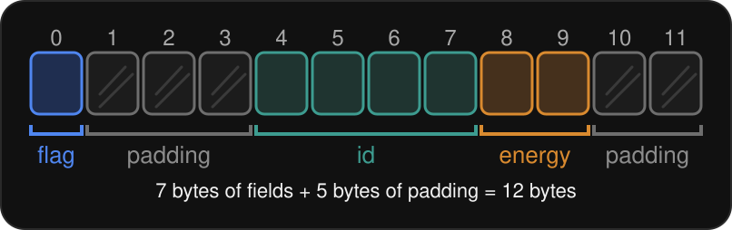
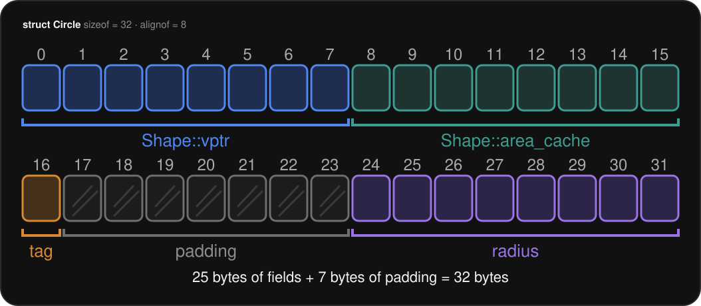
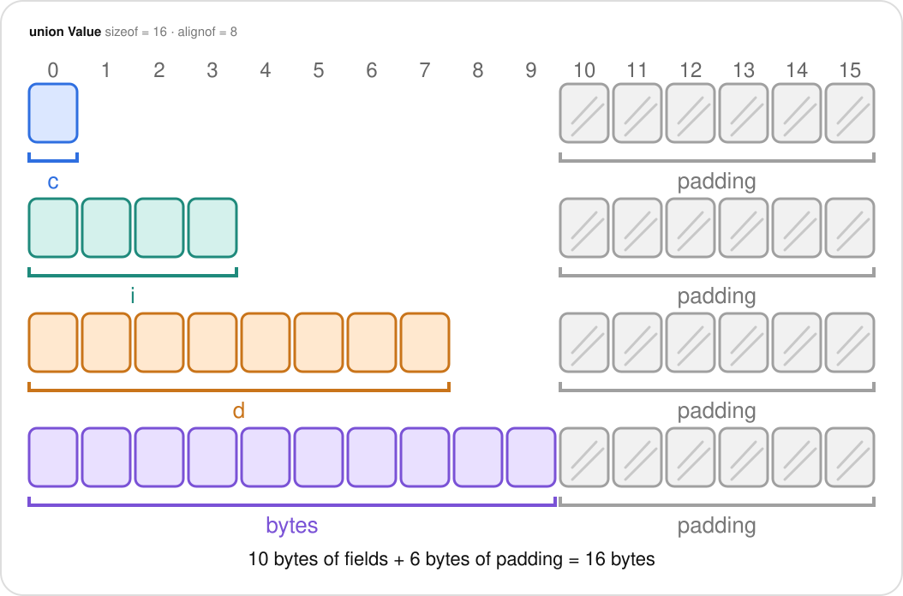

# memlayout

[](../../actions/workflows/ci.yml)

Draw the **real** memory layout of C++ types: sizes, alignment, padding, vptrs,
base classes, bitfields, unions. Nothing is guessed: the layout comes from the compiler.

```
$ memlayout examples/basic.cpp Sample
   0   1   2   3   4   5   6   7   8   9   10  11
  ▒▒▒ ╱╱╱ ╱╱╱ ╱╱╱ ███ ███ ███ ███ ▒▒▒ ▒▒▒ ╱╱╱ ╱╱╱
  └─┘ └─────────┘ └─────────────┘ └─────┘ └─────┘
  fl~   padding         id        energy  padding

  7 bytes of fields + 5 bytes of padding = 12 bytes
```



`-f svg` produces the rounded-cell figures (dark/light theme, hover tooltips per field).

## Install

```sh
curl -fsSL https://github.com/rshrj/memlayout/releases/latest/download/install.sh | sh
```

Installs the latest release to `~/.local/bin` (override with `MEMLAYOUT_INSTALL_DIR`; pin a version with
`MEMLAYOUT_VERSION=v0.1.0`). Prebuilt binaries: macOS arm64 and Linux x86_64, checksum-verified.
`clang++` must be installed at run time (Xcode command line tools on macOS).

**Update:** `memlayout --self-update` (or re-run the command above).
Other platforms: build from source below.

## How it works

1. `clang -Xclang -fdump-record-layouts-complete` gives every record's offsets, `sizeof`,
   `alignof`, vptrs, bases and bitfield bit ranges (parsed in `src/clang_dump.cpp`).
2. The dump has no member sizes, so a tiny probe program (`sizeof(T::m)`, `alignof(...)`)
   is compiled and run to measure each member exactly (`src/layout.cpp`).
   If that fails (e.g. cross-compiling), sizes are inferred from offsets and flagged.
3. Bytes not covered by any member are padding. Overlapping members (unions) get one lane each.
4. Renderers: `term`, `svg`, `table`, `json`.

Private members work (`-fno-access-control`). Template instances are named explicitly:
`memlayout file.cpp 'Buffer<short, 3>'`.

## Build

```
cmake -S . -B build && cmake --build build && ctest --test-dir build
```
Linux CI runs on clang 18 + libstdc++ 14. On such toolchains clang crashes when dumping every layout, so the tool
automatically falls back to on-demand dumps (types in namespaces then need their qualified name).
Needs a C++23 compiler (std::format, std::expected) and CMake >= 3.20 to build,
and `clang++` on PATH (or `--cxx` / `$CXX`) at run time. POSIX only (macOS/Linux).

## Options

See `memlayout --help`. Highlights: `-f term|svg|table|json`, `-o file|dir/`, `--theme light`,
`-w <bytes per row>`, `-d <depth>` (expand nested structs), `-- <compiler flags>`, `--list`.

## Reading a layout

* Offsets are aligned to the member's `alignof`, so gaps appear (padding between members).
* `sizeof` is rounded up to the struct's `alignof` (tail padding): arrays of the type stay aligned.
* The tool suggests a reordering (descending alignment) when it would shrink a plain struct.
* Empty bases / `[[no_unique_address]]` members take 0 bytes and are omitted from the figure.

## Gallery





## Contributing

Issues and PRs welcome. Run `ctest --test-dir build` before submitting; `.clang-format` is provided.

## License

MIT, see [LICENSE](LICENSE).

## Releasing (maintainers)

1. Bump `project(memlayout VERSION x.y.z)` in `CMakeLists.txt`, commit, push.
2. `git tag vX.Y.Z && git push origin vX.Y.Z`: CI builds/tests the Linux binary and creates the release.
3. `scripts/release-macos.sh vX.Y.Z` on an Apple Silicon Mac attaches the macOS binary
   (macOS CI runners are expensive, so that asset is built locally).
